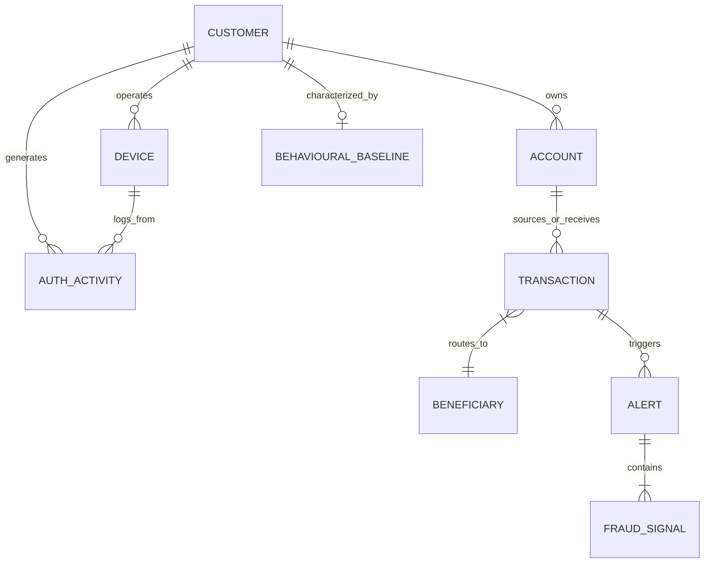

# Domain Model Planning Specification
## Sentient Fraud Intelligence Platform (aXtrLabs)

**Target Bank:** Rawbank (DRC)  
**Phase:** Phase 1 — Project Foundation & Domain Modelling  
**Synthetic Dataset Generation Status:** STRICTLY DEFERRED TO PHASE 2 (No records generated in Phase 1)  
**Schema Authority Note:** Authoritative schema files (`SyntheticData_Fuel`, `SentientData_RuleSet.md`) are currently missing from the local workspace. All attributes defined herein represent necessary structural entities based on core BFSI fraud intelligence standards, with exact field keys and enumerations explicitly flagged as `[To be confirmed from supplied schema]`.

---

### 1. Conceptual Domain Overview

The synthetic banking environment for Rawbank requires a cohesive relational and event-driven data model capable of supporting:
1. Real-time deterministic rule evaluation (velocity, thresholds, impossible travel, new device bindings).
2. Entity graph resolution (linking shared devices, shared phone numbers, mule accounts, counterparty networks).
3. Semantic retrieval and contextual evidence feeding into the Groq LLM Intelligence layer.
4. Cohesive operation between the **Sentient Command Centre** (fleet monitoring) and the **Sentient Fraud Investigation Copilot** (case deep-dive).

---

### 2. Entity Specifications

---

#### 2.1 Customer Entity (`Customer`)

* **Purpose:** Represents the primary retail, SME, corporate, or agent entity holding accounts and transacting through Rawbank channels.
* **Why it Matters to Fraud Investigation:**  
  Fraud analysts must evaluate customer KYC tier, tenure, risk segment, historical dispute history, and normal behavior. ATO attacks target legitimate customers; mule rings recruit low-income individuals to open sacrificial accounts.
* **Relationships:**
  * 1-to-Many with `Account` (a customer may own CDF and USD accounts, plus an IllicoCash wallet).
  * 1-to-Many with `Device` (registered and active phones/browsers).
  * 1-to-Many with `AuthActivity` (all authentication attempts and session logs).
  * 1-to-1 with `BehaviouralBaseline` (historical statistical profile).
* **Attributes:**
  * `customer_id` (Primary Key, e.g. `RAW-CUST-10492`)
  * `full_name` [To be confirmed from supplied schema]
  * `customer_segment` (Enum: `Retail`, `HNWI`, `SME`, `Corporate`, `AgencyBankingOperator`) [To be confirmed from supplied schema]
  * `kyc_status` (Enum: `Tier_1_Basic`, `Tier_2_Standard`, `Tier_3_Full`, `Non_Compliant`) [To be confirmed from supplied schema]
  * `primary_phone` (Congolese MSISDN, e.g., `+243-81-XXX-XXXX`) [To be confirmed from supplied schema]
  * `national_id_hash` / `passport_hash` [To be confirmed from supplied schema]
  * `onboarding_timestamp` (ISO 8601 UTC) [To be confirmed from supplied schema]
  * `registered_city` (e.g., `Kinshasa`, `Lubumbashi`, `Goma`, `Kolwezi`, `Matadi`) [To be confirmed from supplied schema]
  * `risk_category` (Enum: `Low`, `Medium`, `High`, `PEP_Sanction_Watchlist`) [To be confirmed from supplied schema]

---

#### 2.2 Account Entity (`Account`)

* **Purpose:** Represents the balance-holding financial ledger entity (Current, Savings, IllicoCash Mobile Wallet, Agent Float).
* **Why it Matters to Fraud Investigation:**  
  Accounts are the financial nodes where balances are accumulated, structured, drained, or parked. Detecting rapid balance depletion (bust-out) or sudden influx of funds followed by instant cash-out requires granular account-level tracking.
* **Relationships:**
  * Many-to-1 with `Customer`.
  * 1-to-Many with `Transaction` (as sender account or recipient account).
* **Attributes:**
  * `account_id` (Primary Key, e.g. `ACC-RAW-0092144`)
  * `customer_id` (Foreign Key -> `Customer.customer_id`)
  * `account_type` (Enum: `Current_Checking`, `Savings_Deposit`, `IllicoCash_Mobile_Wallet`, `Agent_Float_Ledger`) [To be confirmed from supplied schema]
  * `currency` (Enum: `CDF`, `USD`) [To be confirmed from supplied schema]
  * `current_balance` (Decimal) [To be confirmed from supplied schema]
  * `available_balance` (Decimal) [To be confirmed from supplied schema]
  * `account_status` (Enum: `Active`, `Dormant`, `Frozen`, `Under_Investigation`, `Closed`) [To be confirmed from supplied schema]
  * `created_at` (ISO 8601 UTC) [To be confirmed from supplied schema]

---

#### 2.3 Transaction Entity (`Transaction`)

* **Purpose:** Represents an atomic financial movement event across Rawbank digital, physical, or interbank payment channels.
* **Why it Matters to Fraud Investigation:**  
  Transactions are the primary observable action of fraudulent behavior. Transaction velocity, out-of-pattern amount, unusual timing (e.g. 03:00 AM), unfamiliar channel, and high-risk destination are direct fraud markers.
* **Relationships:**
  * Many-to-1 with `Account` (source / debtor).
  * Many-to-1 with `Beneficiary` / destination account (counterparty / creditor).
  * Many-to-1 with `Device` (initiating hardware).
  * 1-to-Many with `Alert` (a transaction can trigger zero, one, or multiple fraud rules).
* **Attributes:**
  * `transaction_id` (Primary Key, e.g. `TX-2026-90412`)
  * `source_account_id` (Foreign Key -> `Account.account_id`)
  * `channel` (Enum: `IllicoCash_App`, `RawbankOnline_Web`, `ATM_Cardless`, `ATM_Card`, `Agency_Express_POS`, `Branch_Teller`, `SWIFT_Wire`) [To be confirmed from supplied schema]
  * `transaction_type` (Enum: `P2P_Transfer`, `Merchant_QR_Payment`, `ATM_CashOut`, `Agent_CashOut`, `Agent_CashIn`, `Bulk_Payroll_Credit`, `FX_Exchange_CDF_USD`, `Bill_Payment`) [To be confirmed from supplied schema]
  * `amount` (Decimal) [To be confirmed from supplied schema]
  * `currency` (Enum: `CDF`, `USD`) [To be confirmed from supplied schema]
  * `amount_usd_equivalent` (Standardized USD baseline value) [To be confirmed from supplied schema]
  * `timestamp` (ISO 8601 UTC) [To be confirmed from supplied schema]
  * `location_city` (e.g. `Kinshasa`) [To be confirmed from supplied schema]
  * `location_lat_long` (Geo-coordinates) [To be confirmed from supplied schema]
  * `device_id` (Foreign Key -> `Device.device_id`) [To be confirmed from supplied schema]
  * `status` (Enum: `Completed`, `Pending_Review`, `Blocked_Declined`, `Reversed`) [To be confirmed from supplied schema]

---

#### 2.4 Beneficiary / Counterparty Entity (`Beneficiary`)

* **Purpose:** Represents the recipient of transferred funds, including internal Rawbank accounts, third-party mobile money wallets (Vodacom M-Pesa, Airtel Money, Orange Money), interbank recipients, or international SWIFT counterparties.
* **Why it Matters to Fraud Investigation:**  
  Mule networks and laundering rings repeatedly use the same cluster of destination accounts. First-time beneficiaries, newly added payees followed by immediate maximum-limit transfers, and mule funnel accounts are premier fraud indicators.
* **Relationships:**
  * 1-to-Many with `Transaction`.
  * Many-to-1 with `Customer` (saved beneficiary lists).
* **Attributes:**
  * `beneficiary_id` (Primary Key, e.g. `BEN-88310`)
  * `beneficiary_name` [To be confirmed from supplied schema]
  * `destination_institution` (e.g., `Rawbank_Internal`, `Vodacom_M_Pesa`, `Airtel_Money`, `EquityBCDC`, `Citi_NewYork`) [To be confirmed from supplied schema]
  * `destination_account_or_msisdn` (Account number or phone number) [To be confirmed from supplied schema]
  * `first_associated_timestamp` (When first introduced to the customer's profile) [To be confirmed from supplied schema]
  * `is_known_mule_flag` (Boolean - calculated risk flag) [To be confirmed from supplied schema]

---

#### 2.5 Device & Session Entity (`Device`)

* **Purpose:** Captures the hardware and software environment used by a customer to access Rawbank digital banking services.
* **Why it Matters to Fraud Investigation:**  
  Credential stuffing and ATO almost universally occur from an unrecognized device or IP. Rapid device switching, device emulator signatures, rooted/jailbroken devices, and impossible geographic travel between consecutive device sessions are critical deterministic signals.
* **Relationships:**
  * Many-to-1 with `Customer` (registered devices).
  * 1-to-Many with `Transaction`.
  * 1-to-Many with `AuthActivity`.
* **Attributes:**
  * `device_id` (Primary Key, e.g. `DEV-A9842F1`)
  * `customer_id` (Foreign Key -> `Customer.customer_id`)
  * `device_fingerprint_hash` [To be confirmed from supplied schema]
  * `device_model` (e.g. `Samsung Galaxy A14`, `Tecno Spark 10`, `iPhone 14`, `Chrome Windows 11`) [To be confirmed from supplied schema]
  * `os_version` [To be confirmed from supplied schema]
  * `ip_address` [To be confirmed from supplied schema]
  * `ip_country` / `ip_city` [To be confirmed from supplied schema]
  * `is_vpn_or_tor` (Boolean) [To be confirmed from supplied schema]
  * `is_rooted_jailbroken` (Boolean) [To be confirmed from supplied schema]
  * `first_seen_timestamp` (ISO 8601 UTC) [To be confirmed from supplied schema]
  * `trust_status` (Enum: `Trusted_Enrolled`, `New_Unverified`, `Suspicious_Blacklisted`) [To be confirmed from supplied schema]

---

#### 2.6 Authentication & Activity Entity (`AuthActivity`)

* **Purpose:** Logs all security-critical non-financial and access actions taken on digital channels (logins, credential resets, OTP requests, profile edits).
* **Why it Matters to Fraud Investigation:**  
  Fraud is almost always preceded by reconnaissance: multiple failed logins followed by a successful login, password reset, recipient addition, and immediate transfer. Without auth logs, an analyst cannot distinguish an authorized customer transfer from an ATO.
* **Relationships:**
  * Many-to-1 with `Customer`.
  * Many-to-1 with `Device`.
* **Attributes:**
  * `activity_id` (Primary Key, e.g. `AUTH-LOG-91421`)
  * `customer_id` (Foreign Key -> `Customer.customer_id`)
  * `device_id` (Foreign Key -> `Device.device_id`)
  * `event_type` (Enum: `Login_Success`, `Login_Failed_InvalidPIN`, `OTP_Requested`, `OTP_Verified`, `Password_Reset_Triggered`, `Biometric_Auth_Success`, `Beneficiary_Added`, `Device_Enrolled`) [To be confirmed from supplied schema]
  * `timestamp` (ISO 8601 UTC) [To be confirmed from supplied schema]
  * `channel` (Enum: `IllicoCash`, `RawbankOnline`) [To be confirmed from supplied schema]
  * `failure_reason` (Nullable string) [To be confirmed from supplied schema]

---

#### 2.7 Alert & Fraud Signal Entity (`Alert` & `FraudSignal`)

* **Purpose:**
  * `Alert`: The composite operational ticket generated when one or more rules trigger on a transaction, customer, or account.
  * `FraudSignal`: Individual discrete deterministic rule breach or anomaly marker that contributes to the alert.
* **Why it Matters to Fraud Investigation:**  
  The core currency of the **Sentient Command Centre** is the prioritised `Alert` queue. The **Sentient Fraud Investigation Copilot** references individual `FraudSignal` items as verified evidence tokens.
* **Relationships:**
  * Many-to-1 with `Transaction` (or `Customer`).
  * 1-to-Many with `FraudSignal`.
* **Attributes (`Alert`):**
  * `alert_id` (Primary Key, e.g. `ALT-2026-00481`)
  * `transaction_id` (Foreign Key -> `Transaction.transaction_id`)
  * `customer_id` (Foreign Key -> `Customer.customer_id`)
  * `composite_risk_score` (Integer 0–100) [To be confirmed from supplied schema]
  * `severity` (Enum: `CRITICAL`, `HIGH`, `MEDIUM`, `LOW`) [To be confirmed from supplied schema]
  * `status` (Enum: `NEW_UNASSIGNED`, `UNDER_INVESTIGATION`, `ESCALATED_AML`, `DISMISSED_FALSE_POSITIVE`, `RESOLVED_CONFIRMED_FRAUD`) [To be confirmed from supplied schema]
  * `assigned_analyst` (Nullable string) [To be confirmed from supplied schema]
  * `created_at` (ISO 8601 UTC) [To be confirmed from supplied schema]
* **Attributes (`FraudSignal`):**
  * `signal_id` (Primary Key, e.g. `SIG-9912`)
  * `alert_id` (Foreign Key -> `Alert.alert_id`)
  * `rule_code` (e.g. `R-VEL-01`, `R-ATO-03`, `R-GEO-02`, `R-MULE-05`) [To be confirmed from SentientData_RuleSet.md]
  * `rule_name` [To be confirmed from SentientData_RuleSet.md]
  * `rule_category` (Enum: `Velocity`, `Anomaly`, `Credential_ATO`, `Structuring`, `Device_Risk`, `Geographic_Travel`) [To be confirmed from supplied schema]
  * `confidence_weight` (Float 0.0–1.0) [To be confirmed from supplied schema]
  * `signal_description` (Human-readable deterministic finding) [To be confirmed from supplied schema]

---

#### 2.8 Behavioural Baseline Entity (`BehaviouralBaseline`)

* **Purpose:** Represents the precomputed 30/60/90-day normal profile of a customer, establishing their statistical standard deviation boundaries.
* **Why it Matters to Fraud Investigation:**  
  AI reasoning and copilot investigations require counter-evidence and deviation analysis. If a customer has transacted $10,000 monthly for 3 years, a $10,000 transaction is not suspicious. If their historical maximum is $150, a $10,000 transfer is an extreme deviation.
* **Relationships:**
  * 1-to-1 with `Customer`.
* **Attributes:**
  * `baseline_id` (Primary Key)
  * `customer_id` (Foreign Key -> `Customer.customer_id`)
  * `avg_monthly_volume_usd` [To be confirmed from supplied schema]
  * `max_single_tx_amount_usd` [To be confirmed from supplied schema]
  * `typical_active_hours_utc` (Array of hours, e.g. `[07, 08, ..., 20]`) [To be confirmed from supplied schema]
  * `common_channels` (Array of strings, e.g. `["IllicoCash_App"]`) [To be confirmed from supplied schema]
  * `frequent_beneficiary_ids` (Array of IDs) [To be confirmed from supplied schema]
  * `frequent_cities` (Array of strings, e.g. `["Kinshasa"]`) [To be confirmed from supplied schema]
  * `last_calculated_at` (ISO 8601 UTC) [To be confirmed from supplied schema]

---

### 3. Entity Resolution & Graph Linkages

To uncover coordinated fraud rings and mule syndicates, the domain model defines explicit resolution paths:
1. **Device Sharing Resolution:** `Device.device_id` linked across multiple distinct `Customer.customer_id` records indicates credential harvesting, phone sharing, or syndicate operation.
2. **Contact Interception Resolution:** Distinct `Customer` records sharing the identical `primary_phone` or recovery email address.
3. **Mule Fan-In / Fan-Out Resolution:** A central `Beneficiary` receiving rapid incoming transactions from dozens of separate source accounts within minutes, immediately followed by cash-out transactions.
4. **Geo-Velocity Resolution:** Successive transactions on the same `Customer` from geographically distant locations (`Kinshasa` and `Goma` 30 minutes apart) indicating credential sharing or proxy evasion.

---

### 4. Phase 2 Generation Readiness

In Phase 2, when synthetic data generation is initiated:
* Exactly **2,500 synthetic records** (or the exact breakdown specified in `SyntheticData_Fuel`) will be constructed.
* Synthetic data will be strictly validated against these entity schemas.
* No records will be generated or hardcoded before schema confirmation.
